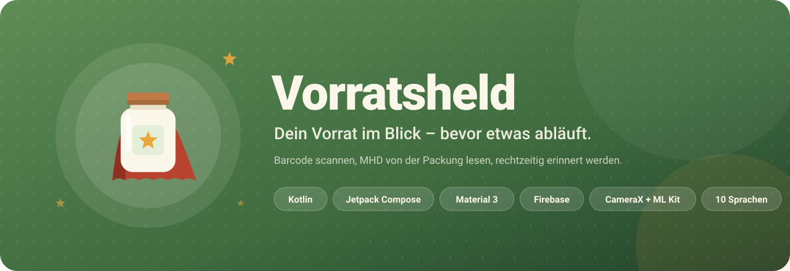
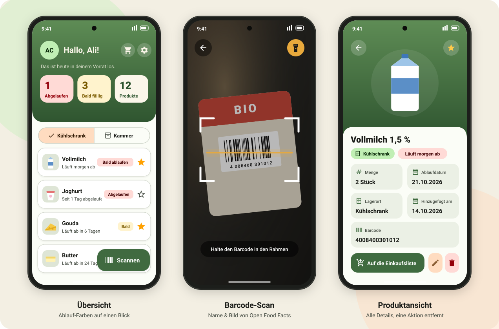
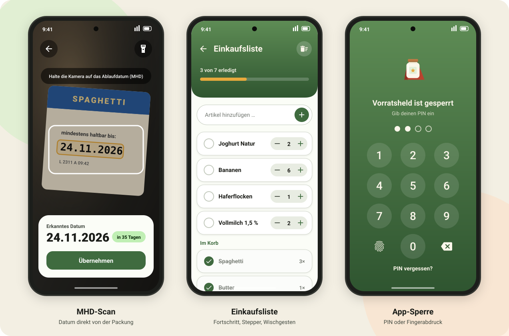
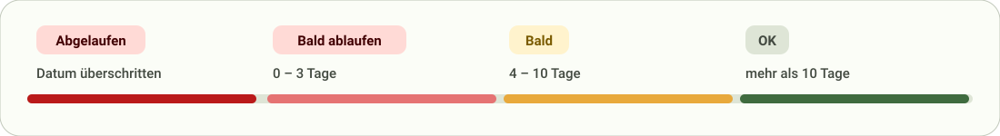
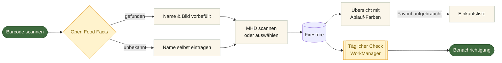
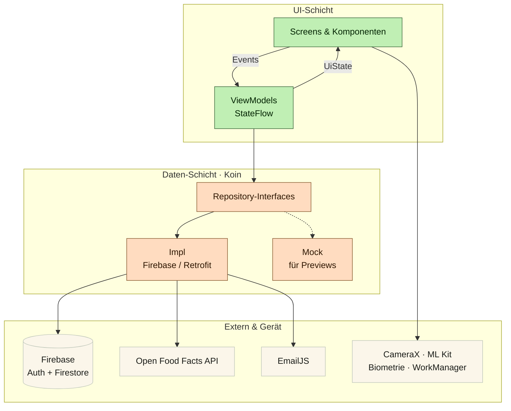
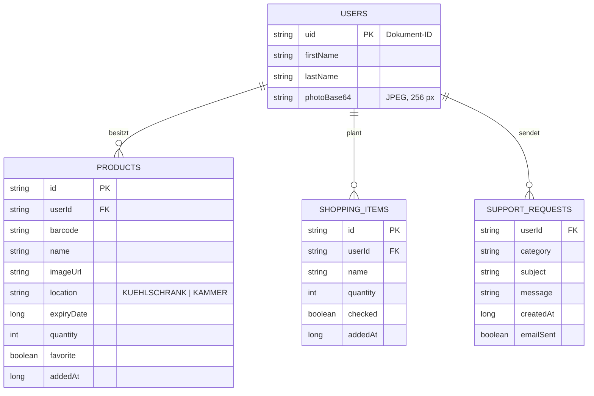

<div align="center">



<br/>
<br/>


**Vorratsheld** ist eine Android-App, die den Vorrat zu Hause verwaltet – vom Barcode-Scan bis zur Erinnerung, bevor etwas im Müll landet.

[Funktionen](#funktionen) · [Screens](#screens) · [Architektur](#architektur) · [Tech-Stack](#tech-stack) · [Einrichten](#einrichten)

</div>

---

## Warum Vorratsheld?

In vielen Haushalten landen Lebensmittel im Müll, weil niemand mehr weiß, was im Kühlschrank steht und wann es abläuft. Vorratsheld löst das mit drei Handgriffen:

1. **Barcode scannen** – Name und Bild kommen automatisch von Open Food Facts.
2. **MHD von der Packung lesen** – die Kamera erkennt das Datum direkt auf dem Etikett.
3. **Zurücklehnen** – die App erinnert rechtzeitig und füllt die Einkaufsliste mit Lieblingsprodukten.

---

## Screens

<div align="center">

<br/><br/>

<br/>
<sub>Design-Vorschau, nachgezeichnet aus dem Compose-Layout der App (Farben, Texte und Aufbau wie im Code).</sub>
</div>

---

## Funktionen

<table>
<tr>
<td width="50%" valign="top">

### Barcode-Scan
CameraX liefert das Live-Bild, ML Kit erkennt den Barcode. Produktname und Bild kommen über Retrofit von der Open Food Facts API – der Nutzer muss nur noch das Datum bestätigen.

</td>
<td width="50%" valign="top">

### MHD-Erkennung
Texterkennung komplett **auf dem Gerät** (ML Kit, offline). Ein eigener Parser erkennt `24.11.2026`, `24/11/26`, `11.2026` oder `NOV 2026`, achtet auf Schlüsselwörter wie *MHD*, *Best before* oder *DLC* und ignoriert das Herstelldatum. Taschenlampe inklusive.

</td>
</tr>
<tr>
<td valign="top">

### Übersicht mit Ablauf-Farben
Kühlschrank und Kammer getrennt, sortiert nach Ablaufdatum. Drei Kennzahlen im Kopf zählen animiert hoch. Nach links wischen zum Bearbeiten oder Löschen – mit **Rückgängig**.

</td>
<td valign="top">

### Erinnerungen
Ein täglicher Hintergrund-Check mit **WorkManager** prüft den Vorrat und schickt eine gesammelte Benachrichtigung, wenn etwas bald abläuft.

</td>
</tr>
<tr>
<td valign="top">

### Einkaufsliste
Abhaken, Menge per Stepper, Wischen zum Löschen und ein Fortschrittsbalken. Wird ein **Favorit** aufgebraucht, landet er automatisch auf der Liste.

</td>
<td valign="top">

### App-Sperre
Eigener 4-stelliger PIN, alternativ **Fingerabdruck oder Gesichtserkennung** über BiometricPrompt. Die Sperrzeit ist einstellbar (sofort, 1 Minute, 5 Minuten, nur beim Start).

</td>
</tr>
<tr>
<td valign="top">

### Konto & Profil
Registrierung und Login mit Firebase Auth, Profilbild (auf 256 px verkleinert), E-Mail und Passwort ändern, Konto inklusive aller Daten löschen.

</td>
<td valign="top">

### 10 Sprachen
Deutsch, Englisch, Türkisch, Arabisch, Französisch, Spanisch, Italienisch, Polnisch, Russisch und Ukrainisch – umschaltbar direkt in der App, Arabisch **von rechts nach links**.

</td>
</tr>
</table>

### Ablauf-Farben auf einen Blick



---

## So funktioniert's



---

## Architektur

Die App folgt **MVVM** mit Repository-Pattern. Jede Datenquelle steckt hinter einem Interface – im Betrieb die Firebase- bzw. API-Umsetzung, in den Compose-Previews ein Mock. Koin verbindet alles: ViewModels und Repositories werden zentral im `AppModule` erzeugt. So laufen alle Previews ohne Internet und ohne Firebase.



### Datenmodell (Firestore)



---

## Tech-Stack

| Bereich | Technologie |
|---|---|
| **Sprache** | Kotlin 2.4 |
| **UI** | Jetpack Compose, Material 3, eigenes Farbschema (Hell & Dunkel) |
| **Architektur** | MVVM, Repository-Pattern, Unidirectional Data Flow |
| **Dependency Injection** | Koin |
| **Navigation** | Navigation Compose mit typsicheren Routen (`@Serializable`), Argumente per `SavedStateHandle` |
| **Backend** | Firebase Authentication (`AuthStateListener` als Flow), Cloud Firestore mit DTOs und eigenen Sicherheitsregeln |
| **Netzwerk** | Retrofit + Moshi (Open Food Facts, EmailJS) |
| **Bilder** | Coil 3, Android Photo Picker |
| **Kamera & Erkennung** | CameraX, ML Kit Barcode Scanning, ML Kit Text Recognition |
| **Lokal** | Preferences DataStore |
| **Hintergrund** | WorkManager, Notification Channels |
| **Sicherheit** | androidx.biometric, gesalzener SHA-256-Hash für den PIN |
| **Datum** | kotlinx-datetime |

<details>
<summary><b>Zahlen zum Projekt</b></summary>
<br/>

| | |
|---|---|
| Kotlin-Dateien | 151 |
| Zeilen Code | ~ 9.700 |
| Compose-Previews | 31 |
| Screens | 15 |
| Sprachen | 10 |
| Mindest-Android-Version | 7.0 (API 24) |

</details>

---

## Sicherheit & Datenschutz

- **PIN nie im Klartext** – gespeichert wird nur ein gesalzener SHA-256-Hash mit 10.000 Runden.
- **Firestore-Regeln** sorgen dafür, dass jeder Nutzer ausschließlich seine eigenen Produkte, Listen und sein Profil lesen und ändern kann ([`firestore.rules`](firestore.rules)).
- **Texterkennung offline** – Fotos der Verpackung verlassen das Gerät nicht.
- **Sperre beim Zurückkehren** – nach einstellbarer Zeit im Hintergrund fragt die App erneut nach PIN oder Biometrie.
- **Konto löschen** entfernt Produkte, Einkaufsliste, Profil und Login vollständig.

---

## Projektstruktur

```
app/src/main/java/com/example/vorratsheld/
├── biometric/        Fingerabdruck & Gesicht (BiometricPrompt)
├── camera/           Kamera-Vorschau, Barcode- und MHD-Scanner
├── data/
│   ├── enums/        Lagerort, Ablauf-Stufen, Sprachen, …
│   ├── model/        Data Classes (Product, ShoppingItem, …)
│   ├── remote/       Retrofit-APIs, DTOs, Collection-Namen
│   ├── repository/   Interface · Impl · Mock
│   └── settings/     Lokale Einstellungen (DataStore)
├── di/               App-Klasse (startet Koin) und AppModule
├── notification/     Channel & Erinnerungs-Abfrage
├── ui/
│   ├── AppStart.kt   Einstiegspunkt der UI
│   ├── components/   Wiederverwendbare Composables
│   ├── navigation/   NavGraph & Routen
│   ├── screens/      Ein Ordner pro Screen
│   ├── state/        UiStates
│   ├── theme/        Farben, Formen, Typografie
│   └── viewmodel/    ViewModels
├── util/             Helper (Datum, MHD-Parser, Bilder, …)
└── worker/           Täglicher Ablauf-Check
```

---

## Einrichten

**Voraussetzungen:** Android Studio (aktuelle Version), JDK 17, ein Firebase-Projekt.

```bash
git clone https://github.com/Ali313/Vorratsheld-Android.git
```

1. Projekt in Android Studio öffnen und Gradle synchronisieren.
2. In der [Firebase-Konsole](https://console.firebase.google.com) eine Android-App mit dem Paketnamen `com.example.vorratsheld` anlegen und die `google-services.json` nach `app/` legen.
3. **Authentication** (E-Mail/Passwort) und **Cloud Firestore** aktivieren, danach die Regeln aus [`firestore.rules`](firestore.rules) veröffentlichen.
4. *Optional:* Zugangsdaten von [EmailJS](https://www.emailjs.com) in `data/remote/EmailJsConfig.kt` eintragen – ohne werden Support-Anfragen nur in Firestore gespeichert.
5. Run-Konfiguration **app** starten.

> **Tipp:** Alle Screens haben Compose-Previews mit Mock-Daten – zum Durchklicken der Oberfläche braucht es weder Emulator noch Firebase.

---

## Ausblick

- [ ] Unit-Tests für ViewModels und den MHD-Parser
- [ ] Alternative Backend-Umsetzung mit **Supabase** hinter denselben Repository-Interfaces
- [ ] Echte Screenshots und Demo-Video

---

<div align="center">


**Vorratsheld** · entwickelt von **Ali Chehab** im Rahmen der Android-Weiterbildung am Syntax Institut

[](https://github.com/Ali313)

</div>
